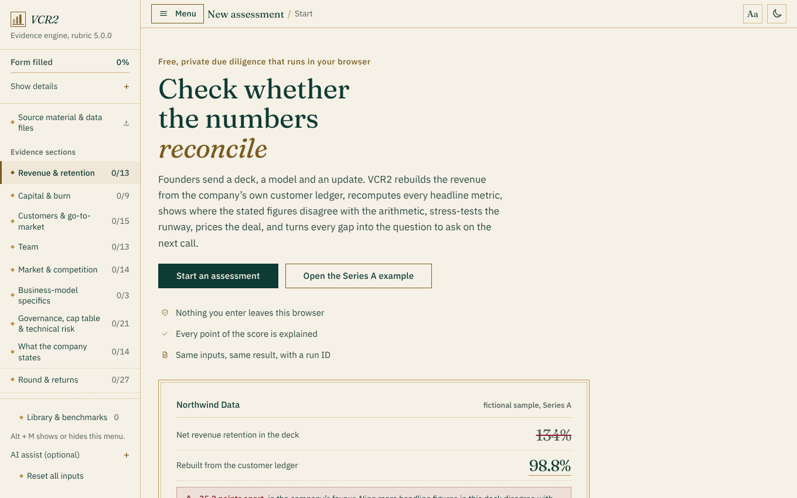
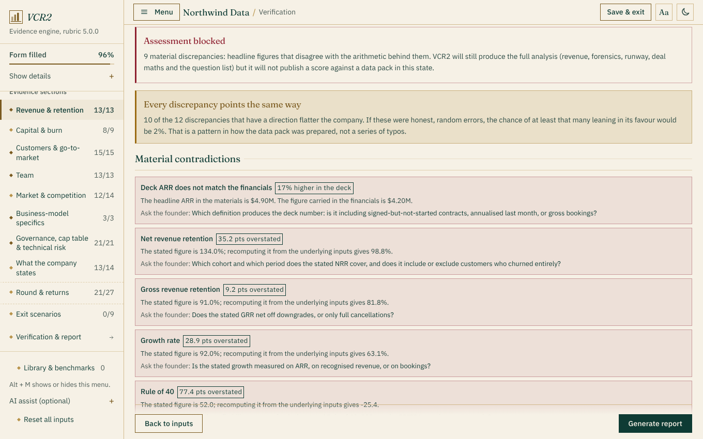
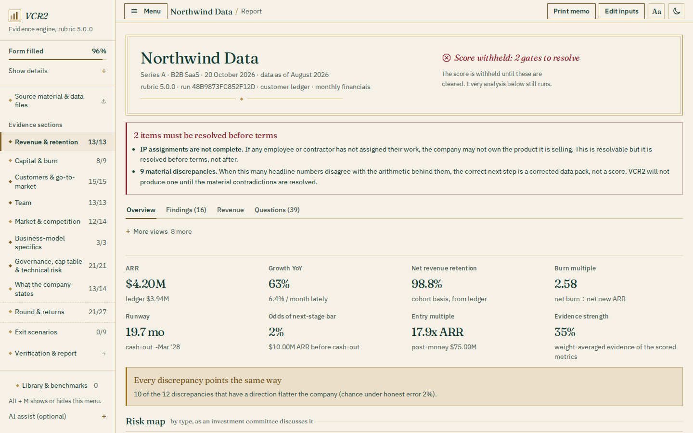

<h1 align="center">VCR2</h1>

<p align="center">
  <strong>Check whether the numbers reconcile.</strong><br>
  Evidence-first due diligence for venture investors. Free, private, and every rule in it is yours to set.
</p>

<p align="center">
  <a href="https://dsaxel05.github.io/VCR2/"><strong>Open the live app</strong></a>
  &nbsp;·&nbsp;
  <a href="docs/media/demo.mp4">Watch the one-minute video</a>
  &nbsp;·&nbsp;
  <a href="#what-it-does">What it does</a>
  &nbsp;·&nbsp;
  <a href="#methodology">Methodology</a>
</p>

<p align="center">
  <a href="CHANGELOG.md"></a>
  <a href="https://dsaxel05.github.io/VCR2/"></a>
  <a href="https://github.com/dsaxel05/VCR2/actions/workflows/tests.yml"></a>
  <a href="LICENSE"></a>
  
  
</p>

<p align="center">
  <a href="docs/media/demo.mp4">
    
  </a>
</p>

---

## The problem

A founder sends a deck, a model and an update. The headline numbers (NRR, growth, CAC payback, runway, Rule of 40) are usually *stated*, not *derived*, and they often do not reconcile with the company's own raw data. A deck that says **134%** net revenue retention while the customer ledger gives **98.8%** is a typical diligence catch, and an easy one to miss on a first read. Rebuilding the numbers by hand takes an associate days of spreadsheet work per deal.

VCR2 rebuilds them from the raw figures in about a second, shows its working, never hides a judgement inside a black box, and turns every gap into the question to ask on the next call.

## See it

**Start.** Open the built-in fictional example or begin with your own files.

<p align="center"></p>

**Verify.** Every stated figure against the arithmetic behind it, each with the question to ask the founder.

<p align="center"></p>

**Report.** Metrics, risks, runway odds and deal maths in one place. Here the score is withheld until the contradictions are resolved.

<p align="center"></p>

## Try it in 30 seconds

1. Open **[dsaxel05.github.io/VCR2](https://dsaxel05.github.io/VCR2/)**.
2. Click **Open the Series A example** (Northwind Data, a fictional company with synthetic data). A clean seed-stage example is on the same page.
3. Go to **Verification & report**, then **Generate report**.

No account, no API key. To use your own data, choose **Start an assessment** and drop a customer revenue ledger into **Give it the source material**. Sample files are in [`examples/`](examples/).

## What it does

| | |
|---|---|
| **Rebuilds revenue from the ledger** | Upload revenue by customer by month: any billing-system export, wide or long, as CSV or straight from Excel (.xlsx, read in the browser with no library). VCR2 builds the monthly MRR bridge (new, expansion, reactivation, contraction, churn), which closes to the dollar, plus **true cohort NRR and GRR**, logo retention, concentration (top 1/5/10, HHI) and cohort heatmaps. It also shows how far a waterfall-style NRR is inflated by expansion from customers acquired during the year. |
| **Stated vs. computed** | Consistency checks compare what the company states with what the underlying figures and the ledger produce. A **binomial test** flags when the discrepancies all happen to flatter the company: honest errors point both ways. |
| **Forensics on billing data** | Nine tests, each with its method and its limits: final-month booking spikes before a raise, quarter-end pull-forward, one-month "recurring" customers, near-duplicate logos, one-off charges booked as MRR, reactivations hidden in new business, negative entries, growth smoothness, and a Benford first-digit test with an applicability check. |
| **Runway odds, not a runway number** | Paul Graham's *default alive* test, plus a **seeded Monte Carlo** (4,000 paths) with decaying growth and the company's own volatility: the probability of reaching the next-stage ARR bar before cash-out, the runway distribution, and the capital needed to get there at 50% and 80% confidence. |
| **Deal maths to the exit** | Pool shuffle, SAFE and **convertible-note** conversion (with accrued interest) at cap or discount, effective pre-money, ownership at entry and after future dilution, the exit that returns your fund, and a full **liquidation waterfall** (participating, non-participating or capped) with convert-or-take-preference logic. |
| **VC Method and First Chicago** | Downside, base and upside exit cases with probabilities give the multiple and IRR this price produces, the post-money a target return justifies (Sahlman's VC Method, on the success case) and the probability-weighted value (First Chicago). Every assumption is shown and editable. |
| **Term-sheet review** | Liquidation preference, participation and its cap, anti-dilution (full ratchet vs. weighted average), dividends, redemption, pay-to-play, board control, pro-rata and information rights, each compared with the market-standard version (NVCA model documents, YC Series A template). |
| **40+ compound risk patterns** | Growth bought with paid acquisition, leaky bucket, services wearing a software multiple, concentration on short contracts, window dressing before a raise, AI inference-margin trap, off-market terms, a price that cannot clear the target return, weak product-market fit, a discretionary product, a new or non-technical founding team, finance and tax hygiene, and the strengths too. |
| **Risk map** | Every red and amber signal grouped the way an investment committee discusses risk: product, market & timing, execution & team, financial & reporting, legal & regulatory, deal & structure. |
| **Diligence checklist by stage** | Around 60 items across ten data-room categories (founders, financial, tax, cap table & legal, customers, product, IP, HR, security, insurance), scoped to the stage, pre-filled from your inputs and uploads, tracked item by item, and carried into the memo. |
| **Evidence-weighted, stage-calibrated scoring** | Every field records where its number came from (founder said, deck, model, system export, bank record, audited). Weak evidence widens the confidence band and pulls good scores towards 50. Four stage rubrics, four business models, product-market-fit signals (the Sean Ellis 40% test, NPS), hard gates on IP, cap-table and unpaid-tax issues, and metrics withheld below the sample size where they carry signal. Every point of a score is explained. |
| **Learns from your deals** | Save each run to a local **Library**, import comparables from CSV, or paste anything (a newsletter, a portfolio update, meeting notes) and let a model you choose structure it for review. VCR2 then ranks each new company against your own data and can **recalibrate its thresholds on your library**. |
| **An owner Studio** | The owner of the site can change everything that decides how a company is judged (healthy ranges, answer scores, weights, defaults, red-flag triggers, check tolerances), add fields, metrics, checks, deal-breakers, questions, benchmarks, checklist items and business models, and rename or switch off anything built in. Then publish to the live site. No code. [How it works](docs/STUDIO.md) |
| **Output you can use** | A ranked question list, a ready-to-send founder email, a data-room request list, a print-ready **IC memo (PDF)**, Markdown, and a JSON export anyone can re-open. |

### New in v5.0

- **Scores you can explain.** Evidence changes the score (good news needs a source), and "What drove this score" shows where every point comes from.
- **Stricter cross-checks.** A stated figure against a computed zero, SAFE and note conversion solved exactly, impossible deal inputs reported.
- **A sidebar that gets out of the way.** Hide it in one click (Alt + M) to focus on the data.
- **One designed look.** Ivory page, deep-green ink, thin brass lines, large readable type, in light and night.
- **No third-party request at run time**, and a simulation that runs off the main thread.
- **An Owner Studio that can change anything without code.**

Full history in the [changelog](CHANGELOG.md).

## How to use it

1. **What are you looking at?** Company, stage and business model. Stage sets the thresholds and weights; the model selects which metrics are scored.
2. **Give it the source material.** Drop in the customer revenue ledger and monthly financials as CSV or Excel (parsed locally, no AI). Optionally paste the deck, memo or term sheet and extract figures with a model you choose; every extracted value keeps the line it came from.
3. **Evidence.** Review every field and tag where each number came from. Figures the ledger can supply are filled for you; anything entered by hand is checked against it.
4. **Verification, then the report.** Contradictions are shown before any score. The report has twelve views: overview (with the risk map), findings, revenue, forensics, runway & odds, deal & returns (with the VC Method, First Chicago and the term-sheet review), benchmarks, scoring (with a sensitivity tornado and "what would need to be true"), questions, all metrics, the consistency ledger and the diligence checklist.

## Owner Studio

Investors ask for different things. The Studio lets the owner add them without touching code: open **`/#studio`**, sign in with a GitHub token, and change the engine.

| An investor tells you... | You change it in |
|---|---|
| "At Series A, 110% NRR is only average." | **Healthy ranges** |
| "We never invest if one customer is over half of revenue." | **Deal-breakers**: conditions that withhold the score |
| "The runway warning should fire at 15 months, not 12." | **Red-flag triggers**: every built-in trigger and term-sheet norm |
| "A SOC 2 Type I is worth less than you think." | **Scored answers**: the score of every choice and yes/no answer |
| "Model a 5-year exit at 35%, with a 6x multiple." | **Defaults & assumptions** |
| "Deck ARR within 5% of the books is fine." | **Check tolerances** |
| "Median gross margin at Series A is 74% in this report." | **Benchmark data**: quartiles shown in every report |
| "We also look at hardware." | **Business models** |

You can also rewrite any text on the site by clicking it, add metrics computed with a formula (`new_arr_l12 / headcount_sales`), deal-breakers (`top1_pct > 50`) and conditional questions (`nrr < 100 and customers_now >= 20`), and switch off or rename anything built in. The Studio shows what differs from the built-in site, supports undo and redo, previews the effect on the two example companies before you publish, and keeps the publish history.

Only the repository owner can publish. The Studio verifies with GitHub that the token belongs to the owner and can write to the repository, and the live site only ever reads the committed file. Formulas run in a small built-in interpreter: nothing is executed as code, and missing data is never silently treated as zero. Anything that changes scores changes the rubric version printed on every report. Full guide: **[STUDIO.md](docs/STUDIO.md)**.

## Methodology

Everything is deterministic and versioned. The same inputs and rubric version always produce the same score, and every run carries a hash that includes the ledger, the evidence tags and any calibration. The full specification (every formula, tolerance, forensic threshold, the scoring and confidence-band maths, the simulation, the deal conventions and the waterfall algorithm) is in **[METHODOLOGY.md](docs/METHODOLOGY.md)**.

A few of the formulas:

| Metric | Formula |
|---|---|
| Cohort NRR (from the ledger) | today's MRR of customers live 12 months ago ÷ their MRR then |
| Cohort GRR | same base, each customer capped at its starting MRR |
| Burn multiple | net burn over the same twelve months ÷ net new ARR (current burn × 12 when twelve months of financials are not loaded) |
| Magic number | net new ARR in the quarter ÷ prior-quarter S&M |
| CAC payback | CAC ÷ monthly gross profit per customer |
| Effective pre-money | headline pre − (pool top-up + SAFE conversion) × post-money |
| Exit to return the fund | fund size ÷ ownership at exit |
| VC Method post-money | success-case exit × ownership kept ÷ (1 + target return)^years |
| Runway if revenue stopped | cash ÷ gross monthly burn |
| Optimism test | P(X ≥ k), X ~ Binomial(n, ½), over discrepancies that flatter the company |

## Design principles

- **Never ask for a number that can be derived.** Runway, NRR, burn multiple and payback are computed, never typed in.
- **Prefer the company's data to its summary.** A customer ledger outranks a deck; a bank statement outranks a model.
- **Refuse to score bad data.** Three or more material contradictions, or an open IP or cap-table gate, withholds the score. The analysis still runs.
- **Weight evidence, not just values.** Unverified inputs widen the confidence band and count for less in the score.
- **Show the working.** Every metric carries its formula, every test its method and limits.
- **The model never scores.** AI is optional and only extracts figures or drafts prose around numbers the engine has already computed.

## Privacy and security

- The ledger, the derivations, the checks, the simulation and the score all run **entirely in your browser**. Nothing is uploaded anywhere, and there is no VCR2 server.
- The site loads its published configuration (`radar-config.json`) from the same repository. The Owner Studio talks only to `api.github.com`, with the owner's own token.
- **AI is off by default.** The only other network calls are the optional AI features (extraction, AI import, memo narrative), which send text to the provider **you** choose (Anthropic, OpenAI, Gemini, Groq or OpenRouter) using **your own** key and your own account. Nothing is billed to the site owner. Use a restricted, low-spend key and do not paste confidential data-room material into a provider you have not cleared.
- Your AI key is kept in the tab only and forgotten when you close it, unless you tick "Remember this key on this computer". It is never in a draft, an export or the library. Your library is stored in your browser's `localStorage`.
- A Content-Security-Policy limits the page to this site, the GitHub API (Studio only) and the five AI providers. Library backups are rebuilt from a whitelist, and a spreadsheet that inflates beyond a budget is refused. Continuous integration fails if the page makes a request to any other host.

See [SECURITY.md](SECURITY.md).

## Honest limits

- Default thresholds are **editable calibrations, not market statistics**. Recalibrating on your own library makes them yours.
- Forensic tests are **reasons to look, never proof**. Price lists, annual true-ups and seasonal businesses produce some of the same shapes, and each test says so.
- The simulation is only as good as its inputs: growth, volatility and spend growth come from the company's own history when available, and every assumption is shown and editable.
- The deal model uses standard conventions (post-money SAFEs, pari passu preferred) and says when it is estimating a missing input.

## Requirements

- **To use VCR2:** a current browser (Chrome, Edge, Firefox or Safari). Nothing to install: open the live site, or open `index.html` from disk.
- **To rebuild or test it:** Python 3.12 or newer (`build.py` uses only the standard library), Node.js 24 for the engine tests, and for the browser tests `pip install -r requirements.txt` followed by `python -m playwright install chromium`.

## Build and run

```bash
python build.py                        # regenerates index.html from src/ (never edit index.html by hand)
python build.py --readable             # the same, without the size reductions, for debugging
node tools/dev_server.mjs --port 8765  # then open http://127.0.0.1:8765
```

`index.html` is one self-contained file and works when opened straight from disk. The fonts in `assets/` must stay next to it.

## Configuration

- `radar-config.json` is the owner's published configuration: every rule, text and look setting. It holds no secrets and is written by the Owner Studio, not by hand.
- `site.json` holds the address the site is published at; the build writes it into the link-preview image address. Change it for your own domain, then run `python build.py`.
- There is no `.env` and no server. The only keys are the ones a visitor pastes themselves for the optional AI features; they stay in that visitor's browser. The Studio token is typed into the Studio by the owner and is never stored in the repository.

## Tests

```bash
for f in tests/*.test.mjs; do node "$f"; done   # engine, scoring, deal maths, importers, security
python tests/jsstrip_test.py                    # the build's size reduction
python tests/css_compact_test.py
PYTHONUTF8=1 python tests/browser/run_all.py    # browser suites (needs requirements.txt and Chromium)
python tools/size_check.py                      # size budget of index.html
python tools/key_scan.py                        # no key-like string anywhere in the tree or the history
```

The same checks run on every push (`.github/workflows`), including a check that `index.html` is a fresh build of `src/`. Tests use invented companies and fake keys only; no real AI provider is ever contacted.

## Project structure

```
index.html            the whole app: one self-contained file, generated by build.py (never edit by hand)
radar-config.json     the owner's published configuration (written by the Studio)
site.json             the address the site is published at (used for the link-preview image)
build.py              rebuilds index.html from src/
requirements.txt      pip packages for the browser tests only

src/                  the source files, concatenated in the order listed in build.py
  shell.html          page skeleton
  style*.css          styles
  core.js             evidence schema, derivations, checks, rubric, scoring, pipeline
  ledger.js           ledger parsing, MRR bridge, cohorts, concentration, forensics
  series.js           monthly financials, trajectory, default-alive
  sim.js              seeded Monte Carlo
  sim-async.js        runs the simulation in a background worker (same numbers)
  deal.js             ownership, dilution, notes, term review, VC Method, First Chicago, waterfall
  checklist.js        stage-based diligence checklist
  patterns.js         compound risk patterns, optimism test, sensitivity
  library.js          local library, CSV and AI import, percentiles, calibration
  charts.js, report.js  the report and its SVG charts
  exports.js          IC memo, founder email, JSON, Markdown
  config.js           configuration layer and the safe formula language
  owner*.js           owner control: text replacements, scoring constants, what differs from built-in
  studio*.js          the owner Studio: panes, details of built-in items, safety (undo, review, history, JSON)
  xlsx.js             dependency-free Excel reader

tests/                engine, archetype, property, configuration, importer, forensic, deal and browser tests
docs/                 METHODOLOGY.md, STUDIO.md, EDITING.md, and the media used in this README
examples/             sample customer ledgers, monthly financials and a comparables template
assets/               self-hosted fonts and the social preview image
tools/                dev server, size and performance budgets, layout and accessibility scans, key scan
```

The engines are also exposed as `window.Radar`: `Radar.assess({...})` runs a full assessment headlessly and returns every metric, check, pattern, projection and question.

## Roadmap

- [ ] Document import (v5.1): drop several files or a .zip, a figure finder with the source line and page, an import report, column mapping with presets
- [ ] Customer reference-call notes into structured signals (AI-assisted, with quotes)
- [ ] Side-by-side comparison of companies, scenario lab, evidence trail on every number
- [ ] Shared team library (optional sync)
- [ ] Revenue-quality checks against invoices and bank receipts
- [ ] More business-model modules (hardware, consumer subscription)

## Disclaimer

VCR2 is a workflow tool. It does not provide investment advice, and its score is not a recommendation to buy or sell any security. The example companies are fictional and their data is synthetic.

## Author

Built by **Axel De Sousa**, Finance and AI Analysis at Menlo College.
[GitHub](https://github.com/dsaxel05) · [LinkedIn](https://www.linkedin.com/in/axeldesousa/)

## Licence

Proprietary. All rights reserved. See [LICENSE](LICENSE). © 2026 Axel De Sousa.
The source is public so it can be read and evaluated, not reused. For licensing or collaboration: ds.axel05@gmail.com.
