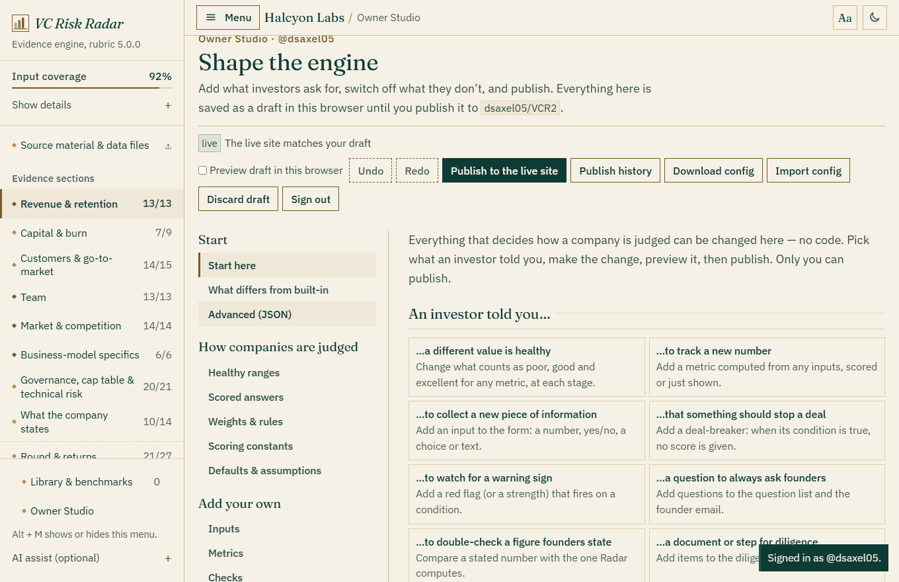

# Owner Studio

The Studio is the owner-only side of VCR2. It lets the owner of the repository change what the engine asks for, computes, checks and reports, and publish those changes to the live site in one click. There is no code to edit.

Everything that decides how a company is judged can be changed here. The Studio opens on a start page that asks what an investor told you and takes you to the right screen.



## If an investor tells you…

| They say | Go to | What you do there |
|---|---|---|
| “At Series A, 110% NRR is only average.” | **Healthy ranges** | Change the poor / good / excellent values of any metric at any stage, with a note on why. Reports mark it “your standard”. |
| “You should track pipeline coverage.” | **Inputs**, then **Metrics** | Add the input (a number, yes/no, choice or text), then a metric computed from it with a formula. Give it thresholds to score it. |
| “We never invest if one customer is over half of revenue.” | **Deal-breakers** | Add a condition (`top1_pct > 50`). While it is true, no score is given and it tops the report, the memo and the founder email. |
| “Burn above 3x with under 15 months of runway is a red flag.” | **Red flags & strengths** | Add a card that fires on a condition, and choose its row on the risk map. |
| “The runway warning should fire at 15 months, not 12.” | **Red-flag triggers** | Change the numbers behind any built-in red flag or strength, and the term-sheet norms (e.g. accept up to 1.5x preference). |
| “A SOC 2 Type I is worth less than you think.” | **Scored answers** | Change the score each answer earns, its weight, and the points of every yes/no answer. |
| “Team matters more than revenue at pre-seed.” | **Weights & rules** | Dimension weights by stage, metric weights, sample-size minimums, the next-stage bar and the score-blocking rule. |
| “Model a 5-year exit at 35%, with a 6x multiple.” | **Defaults & assumptions** | Every value used when a field is blank: exit years, target return, case probabilities, First Chicago rate, growth decay, downside multiple, exit multiple, dilution, option pool, further rounds, runway simulation, stage ARR ranges, evidence weights. |
| “Deck ARR within 5% of the books is fine.” | **Check tolerances** | How big a gap must be before a stated figure is a minor inconsistency, then a material contradiction. |
| “Always ask how much of the pipeline is expansion.” | **Questions** | Add a question to the list and the founder email, always, or only when a condition is true. |
| “Ask for bank statements too.” | **Document requests** / **Checklist** | Add a request to “Documents to request”, or a diligence item (in any category, from any stage). |
| “Median gross margin at Series A is 74% in this report.” | **Benchmark data** | Publish medians and quartiles with the source, one at a time or paste many rows. Reports show where the company sits. |
| “We also look at hardware companies.” | **Business models** | Add a model to the setup page; limit your inputs and metrics to it. |
| “That metric doesn’t matter for us.” | **Switch on or off** | Hide any built-in section, input, metric, answer, check, forensic test, red flag, question family, request, checklist item or deal-breaker. |
| “We call it net dollar retention.” | **Rename** | Rename any built-in input, hint, metric, section, dimension, red flag, deal-breaker or checklist item. |
| n/a | **Texts** | App name, home-page headline, introduction and footnote. |

Every change has a way back: switched-off items come back with one tick, every value can be cleared to return to the built-in one (shown in grey next to yours), and nothing reaches visitors until you publish.

## Everything you can change

| Area | What you can change |
|---|---|
| **Healthy ranges** | For every scored metric and every stage, the values VCR2 reads as poor, good and excellent, with a plain-language reading as you type, the built-in values next to yours, and an optional note on why you changed it (shown in reports as “your standard”). One click takes a metric back to the built-in values. |
| **Scored answers** | The score (0 to 100) of each answer to SOC 2 status, financial statement quality, switching cost, last pricing action, regulatory model and how essential the product is, and each one's weight; the points each yes/no answer adds or removes (0 makes it neutral). |
| **Weights & rules** | Dimension weights by stage, how many material contradictions withhold the score, minimum sample sizes, and the next-stage ARR bar used by the simulation. |
| **Defaults & assumptions** | Exit scenarios (years, target return and probabilities by stage; First Chicago rate; growth decay in the base and upside cases; downside multiple), deal (exit multiple, dilution per round, option pool, further rounds by stage), runway simulation (growth fade, horizon, reserve), stage ARR ranges, and how much each source of evidence counts. Out-of-range values are brought back into range and you see the value actually used. |
| **Inputs** | Add new inputs (number, yes/no, choice list, text), put them in any section or in a new “Additional evidence” section, mark them required, limit them to some business models. |
| **Metrics** | Add metrics computed with a formula from any input or metric. Give one a dimension and stage thresholds and it is scored like a built-in metric; leave it unscored and it is simply shown with its formula. |
| **Checks** | Compare a figure the company states with one VCR2 computes. Set the tolerances, whether an overstatement flatters the company, and the question to ask when it does not reconcile. |
| **Deal-breakers** | Conditions that withhold the score while true, with the reason, the question for the founders and the risk-map row. |
| **Questions** | Add questions to the question list, the founder email and the IC memo, always, or only when a condition is true (`nrr < 100`, `model == 'fintech'`). |
| **Red flags & strengths** | Add risk, watch or strength cards to the overview that fire on a condition (`burn_multiple > 3 and runway < 15`), and choose where each one sits on the risk map. |
| **Document requests** | Add items to “Documents to request”, the memo and the founder email. |
| **Checklist** | Add the diligence items your fund always asks for, in a built-in category or one of your own, from the stage you choose. |
| **Benchmark data** | Medians and 25th/75th percentiles for any metric or numeric input, for one stage or all, with source and year. Pasted rows are put in value order; each report shows the company's position with your source. Benchmarks inform; they do not change the score (use Healthy ranges for that). |
| **Business models** | New models on the setup page, with a name, a description and an icon. Built-in metrics that apply to every model apply to yours. |
| **Switch on or off** | Hide any built-in section, field, scored metric or answer, consistency check, forensic test, red flag, question family, document request, checklist item or deal-breaker. Nothing is deleted; tick it again to bring it back. |
| **Red-flag triggers** | The trigger values of every built-in red flag and strength, and of the term-sheet review (preference, board seat, pool top-up, conversions). |
| **Check tolerances** | The minor and material thresholds of every built-in consistency check. |
| **Rename** | The words your investors use for any built-in field label, field hint, metric, section, dimension, red flag, deal-breaker or checklist item. |
| **Texts** | App name, home-page headline, introduction and footnote, and the name of the custom section. |

### Added in 5.0: full owner control

| Area | What you can change |
|---|---|
| **Edit any text** | Click **Edit texts on the site**, then click any wording on any page (headings, buttons, explanations, disclaimer). Replacements are plain text and also apply to the printed memo, the markdown report and the founder email. |
| **Scoring constants** | The scores at the four anchors (0 / 45 / 72 / 100), the cap on yes/no points, how filled a dimension must be for its full weight, what happens to metrics withheld for a too-small sample (shrink, neutral or leave out), the audited-tag cap, the confidence cut-offs, the likely-range formula, the strong/mixed colours and words, the exit growth floors, and the AI model names. |
| **Healthy ranges → Change** | Besides the four values per stage and the weight: replace the calculation of a built-in metric with your own formula, move it to another dimension, limit it to some business models, change its unit, and edit the healthy range of banded metrics such as the option pool. |
| **Scoring dimensions** | Add up to four dimensions of your own (regulatory risk, ESG…). Put metrics in them and set their weight by stage. |
| **Stages** | Rename the four stages and add stages of your own, scored like a built-in stage. |
| **Business models** | Built-in models can be renamed and hidden, with their own note; your models can start from a built-in one and inherit its metrics, checks and patterns. |
| **Inputs → choice fields** | Give each answer of a choice field you add a score, a dimension and a weight: it becomes a scored answer. |
| **Built-in details** | Quick-pick values, extra choices, group heading, unit and required flag of built-in fields; explanation, request and trigger of each deal-breaker; severity, risk row, explanation and question of each red flag; category, starting stage and reason of each checklist item; wording and dimension of each yes/no point. |
| **Rename** | Also model names, the note under the model cards, evidence source names and consistency check titles. |
| **Red-flag triggers** | Also the thresholds of the forensic tests (final-month spike, one-month customers, quarter-end concentration, Benford). |
| **Check tolerances** | Also deferred revenue, cash against equity raised, the concentration ordering slack, and every form-against-ledger tolerance. |
| **What differs from built-in** | Everything in your draft that is not the built-in site, each with a way back, and a reset for everything. The same count appears on every report. |
| **Advanced (JSON)** | The whole configuration as JSON with live validation, a list of unrecognised keys that will be left out, and Apply. |
| **Safety** | Undo and redo (Ctrl+Z, Ctrl+Y); a review before publishing with the list of changes and the effect on the two example companies; publish history with “load into my draft”; and if a setting ever breaks the engine, the site uses the built-in rules for that page and says so. |

What cannot be a setting is listed, with the reason, in [EDITING.md](EDITING.md).

## Who can use it

Only the owner of the repository. The Studio is not linked from the site; you reach it at:

```
https://vcr2.app/#studio
```

Anyone can open that address, but the Studio stays locked until you sign in with a GitHub token. It then checks with GitHub that the token belongs to the owner of the repository (`dsaxel05`) and can write to it. Publishing works by committing `radar-config.json` to the repository through the GitHub API, which only someone with write access can do. A visitor who got past the lock screen through the browser's developer tools could play with the editor in their own browser, but could not publish anything: the site everyone else sees only ever reads the committed file.

## One-time setup: create the token

1. Go to **github.com/settings/personal-access-tokens/new** while signed in as `dsaxel05`. This is a fine-grained token.
2. **Token name:** `VCR2 Studio`. **Expiration:** **7 days**. You will need a new token when it expires; a short life limits the damage if it leaks.
3. **Repository access:** choose **Only select repositories** and pick **VCR2**.
4. **Permissions → Repository permissions → Contents:** set it to **Read and write**. Leave everything else as it is (GitHub adds read-only “Metadata” automatically).
5. Click **Generate token** and copy it. It starts with `github_pat_`. GitHub shows it only once.
6. Open `https://vcr2.app/#studio`, paste the token and click **Sign in**.

Tick **Keep me signed in on this computer** only on your own machine. Unticked, the token is forgotten when you close the tab. The token is only ever sent to `api.github.com`. If it leaks, delete it at github.com/settings/personal-access-tokens; it can only touch the VCR2 repository.

After the first sign-in, an **Owner Studio** link appears in the sidebar of that browser.

## Everyday use

1. Open the Studio and make your changes. Everything is saved as a **draft in your browser**; visitors see nothing yet.
2. Tick **Preview draft in this browser** to see the whole app with your draft applied. Load an example company to check the new fields, metrics and questions in a real report. Only you see the preview.
3. Click **Publish to the live site**. This commits `radar-config.json` to the repository. GitHub Pages redeploys and visitors get the new version within about a minute.
4. **Discard draft** throws away unpublished changes. **Download config** saves the file; **Import config** loads one into your draft (useful as a backup, or to move a setup between repositories).

If the live configuration changed after you started a draft (you published from another computer, or edited the file on GitHub) the Studio says so and asks whether to start again from the live version or keep your draft. It never overwrites someone else's change silently.

## Formulas

Formulas are evaluated by VCR2’s own small interpreter. Nothing is executed as code, and a formula can only read numbers and text from the current assessment.

| | |
|---|---|
| Arithmetic | `+ - * / ^ ( )` |
| Comparisons | `< <= > >= == !=` |
| Logic | `and`, `or`, `not` |
| Functions | `min(a, b, …)` `max(…)` `abs(x)` `round(x, digits)` `sqrt(x)` `has(x)` `coalesce(a, b, …)` `if(condition, a, b)` |
| Text | `model == 'fintech'` · `stage == 'seed'` · `soc2 == 'Type II'` |
| Yes/no fields | `1` for yes, `0` for no: `litigation == 1` |
| Special names | `stage` (`'preseed' 'seed' 'a' 'b'`), `model` (`'saas' 'ai_app' 'marketplace' 'fintech'`), `arr` (ARR today) |

**Missing data is never treated as zero.** If an input is blank, anything computed from it is “no data”: a metric shows as not computed, a condition does not fire, and a check is skipped. Use `has(x)` to test whether a value exists and `coalesce(x, 0)` to supply a default on purpose.

Every formula box checks what you type as you type it: unknown names, unbalanced brackets and wrong numbers of arguments are shown immediately, with the value the formula gives on the assessment currently loaded. The **Formula help** tab lists every name you can use, including your own fields and metrics. Custom metrics can use each other in any order; a metric that ends up depending on itself shows “no data”.

### Examples

| Goal | Formula |
|---|---|
| New ARR per sales rep | `new_arr_l12 / headcount_sales` |
| Runway after the round, in months | `(cash_on_hand + round_size) / net_burn` |
| Expansion share of new ARR (%) | `expansion_arr_l12 / (new_arr_l12 + expansion_arr_l12) * 100` |
| Ask only for small cohorts with weak retention | `nrr < 100 and customers_now >= 20` |
| Fire a pattern on hard burn and short runway | `burn_multiple > 3 and runway < 15` |
| Check a new claim | stated field: a claim field you added, e.g. `c_stated_pipeline`; computed: `pipeline_coverage` |

## Thresholds and scoring

A scored metric has four values per stage, from lowest to highest. For a higher-is-better metric they score 0, 45, 72 and 100; for a lower-is-better metric they score 100, 72, 45 and 0. The score is interpolated in between. Leave a stage empty and the metric is not scored at that stage. The metric's weight sets its influence inside its dimension; built-in weights range from 0.6 to 2.2.

Anything that changes scores (thresholds, weights, answer scores and yes/no points, hidden items, deal-breakers, check tolerances, evidence weights, custom metrics and checks, settings) changes the rubric version shown on every report, for example `5.0.0+cfg.3f9a2c`. Two reports with the same inputs and the same rubric version always have the same score.

## What the file looks like

`radar-config.json` sits next to `index.html`. You never need to edit it by hand, but it is plain JSON:

```json
{
  "version": 1,
  "fields":  [{ "id": "c_qualified_pipeline", "label": "Qualified pipeline", "section": "custom", "type": "num", "unit": "$", "required": true }],
  "metrics": [{ "key": "m_pipeline_coverage", "label": "Pipeline coverage", "formula": "c_qualified_pipeline / arr_now",
                "unit": "x", "dim": "gtm", "dir": "hi", "weight": 1, "thresholds": { "a": [0.5, 1, 2, 3] } }],
  "questions": [{ "text": "How much of the pipeline is expansion?", "when": "m_pipeline_coverage < 2", "priority": "high" }],
  "gates":   [{ "title": "One customer is over half of revenue", "when": "top1_pct > 50", "ask": "Who is it, and when does the contract renew?" }],
  "patternParams": { "runway_cliff": { "amber": 15, "red": 12 } },
  "categorical": { "soc2": { "Type I": 50 } },
  "defaults": { "exit": { "years": { "a": 5 } }, "deal": { "exit_multiple": 6 } },
  "benchmarks": [{ "metric": "gross_margin", "stage": "a", "p25": 65, "median": 74, "p75": 80, "source": "Survey", "year": "2026" }],
  "hidden":  { "checks": ["stated_arr"], "questions": ["confirm_funds"] }
}
```

Every entry is validated when the site loads. A malformed or partly broken file never breaks the site: invalid entries are skipped and the built-in engine keeps working.

## Look & feel (5.0)

**Site → Look & feel** chooses how the site looks for every visitor. The site has one designed look (an ivory page, deep-green ink, thin brass lines, a serif display face, garnet for risk) in a light and a night theme. You set:

- **Accent**: brass (built in), garnet or emerald; it colours the lines and small accents.
- **Frame** and **divider**: the double hairline and the diamond line on the home page, the report header and the memo, or a single plain line.
- **Default theme for visitors**: light (built in), dark, or follow the visitor's device. Visitors can still switch for themselves with the moon button.
- **Text size**: Normal (built in: body 16 px, labels and table text 14 px), Large or Extra large. Visitors can change it for themselves with the **Aa** button; their choice wins in their own browser.
- **Page scale**: 75% (built in: compact, with the type floors above), 90% or 100%. The two larger scales zoom the whole page (text, spacing, controls) by 1.2 and 1.33.
- **Sidebar on start**: open (built in) or hidden. It is the starting state for a visitor who has not chosen; every visitor can show or hide the menu with the "Menu" button or Alt + M, and that choice stays in their own browser only. Reset puts it back to open.
- **Shape and size**: **corners** (square, softly rounded, round), and the size of **titles and headings**, **figures** (scores and metric values) and **questions** (form labels and the question list): smaller, built in, larger, largest. These sit on top of the text size.
- **Report views in sight**: up to six of the twelve report views stay in the row under the report header, in the order you tick them; the others sit behind "More views".
- **Your colours**: ink and button colour (light and night) and line colour. A colour that would make text hard to read (below 4.5:1 contrast, the WCAG 2.2 AA standard) is kept in your draft but not applied, and the tab says why.

Every choice has a way back to the built-in value. Turn on "Preview draft in this browser" to see a change before you publish. The headline on the home page can highlight a word: put *stars* around it. Everything else on the site can be reworded with **Edit any text**; the title in the browser tab is under **Home page texts**.

## Scoring settings added in 5.0

Under **How companies are judged → Weights & rules**:
- **Evidence adjustment**: off, gentle (default) or strict. How much a score above 50 is pulled towards 50 when its evidence is weak.
- **Customer lifetime cap for LTV**: years (default 5).
- **Overlap cap**: related metrics together weigh at most this many times their largest member (default 2; 0 switches it off).
- **Metrics measured together**: which metrics count as one signal. Every metric is in one group or none; add a group, move a metric, or go back to the built-in groups.
- **Note valuation cap is measured on**: the existing shares (default) or the whole pre-money block including SAFE shares and the pool top-up.

Under **Healthy ranges → Change**, each metric shows where the built-in bar comes from (source, edition, population) above the box for your own source or reason. A healthy range has four values per stage: poor, acceptable, good and excellent.
